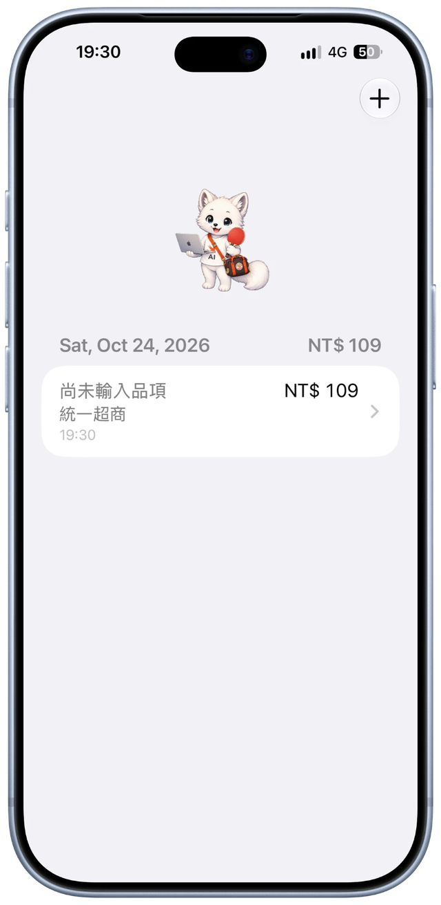
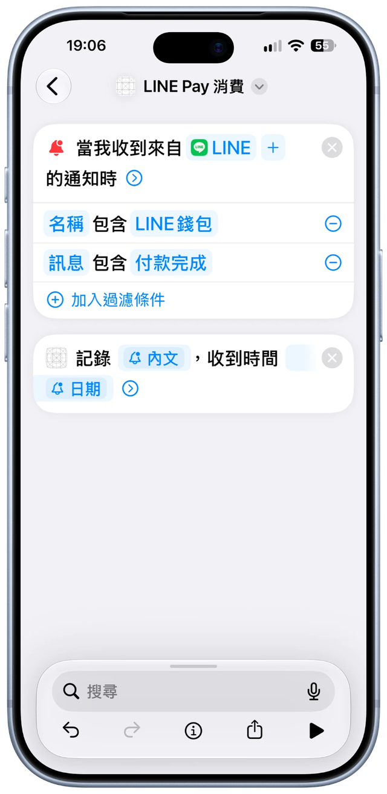

# 🦊 LINE Pay Expense Log

[English](#-english) · [繁體中文](#-繁體中文)


<p align="center">
  
  &nbsp;&nbsp;
  
</p>

---

## 🇬🇧 English

An iOS app that **automatically logs your LINE Pay spending**. When your iPhone receives a LINE Wallet payment notification, a Shortcuts personal automation passes the notification text and the time it arrived to the app through an **App Intent**. The app records the **merchant**, **amount** and **time**; you can add the **item name** by hand later. 🧾

### ✨ Features

- 🔔 **Hands-free logging** – a Shortcuts automation triggers on every LINE Wallet payment notification and runs in the background.
- 🧠 **Smart parsing** – extracts the merchant and amount from the notification text, e.g. `LINE Pay 付款 NT$ 18 付款完成。 商店名稱: 統一超商－天鑫： 回饋: …` → *統一超商－天鑫*, *NT$ 18*.
- ✍️ **Name the item later** – open any record and type what you bought.
- ➕ **Manual entry** – the **+** button adds an expense by hand (merchant, amount, time, item).
- 📅 **Grouped by day** with a daily total, swipe to delete.
- 🛡️ **Safe by design** – refunds and promotional notifications are ignored, and the same notification is never recorded twice.
- 🦊 A cute fox mascot, because why not.

### 🧩 How it works

```
LINE Wallet notification
        │
        ▼
Shortcuts personal automation  ──►  "Record LINE Pay expense" (App Intent)
 (notification body + date)                │
                                           ▼
                              LinePayParser → merchant + amount
                                           │
                                           ▼
                                  SwiftData  ◄──  SwiftUI list / detail
```

### ⚙️ Set up the Shortcuts automation

1. Open **Shortcuts → Automation → New Automation → Notification**.
2. Choose the **LINE** app, then add two filters:
   - **Name** contains `LINE錢包`
   - **Message** contains `付款完成`
3. Add the action **Record LINE Pay expense** (provided by this app) and fill in:
   - **Notification content** → the notification's **Body**
   - **Received time** → the notification's **Date**
4. Set the automation to **Run Immediately** so no confirmation is needed.

> 💡 You can test without paying: create a shortcut with a **Text** action containing a sample notification, then pass it to **Record LINE Pay expense**.

### 🏗️ Project structure

| File | Purpose |
| --- | --- |
| `RecordLinePayExpenseIntent.swift` | App Intent called by Shortcuts (runs in the background) |
| `LinePayParser.swift` | Parses merchant and amount from the notification text |
| `Persistence.swift` | Shared `ModelContainer` + `ExpenseRecorder` (parse, de-duplicate, save) |
| `Expense.swift` | SwiftData model |
| `ContentView.swift` | Daily-grouped expense list |
| `ExpenseDetailView.swift` | Edit the item name, view the original notification |
| `AddExpenseView.swift` | Manual entry form |

### 🚀 Build & run

1. Open `Demo.xcodeproj` in Xcode.
2. Select your own signing team and bundle identifier.
3. Run on an iPhone (the notification automation needs a real device).

### ⚠️ Notes

- The parser is written for the LINE Pay payment-completed notification format shown above. Other formats may need the regular expressions in `LinePayParser.swift` adjusted. The original text is stored with each record, so it can be re-parsed.
- All data stays on the device (SwiftData); nothing is uploaded anywhere.

---

## 🇹🇼 繁體中文

這是一個會**自動記錄 LINE Pay 消費**的 iOS App。當 iPhone 收到 LINE 錢包的付款通知時，「捷徑」的個人自動化會透過 **App Intents**，把通知內容和收到通知的時間傳給 App，App 會記錄**消費商家**、**金額**和**時間**，**品項名稱**則可以事後手動輸入。🧾

### ✨ 功能

- 🔔 **全自動記錄** – 每次收到 LINE 錢包付款通知，捷徑會自動在背景執行。
- 🧠 **自動解析** – 從通知文字取出商家與金額，例如 `LINE Pay 付款 NT$ 18 付款完成。 商店名稱: 統一超商－天鑫： 回饋: …` → *統一超商－天鑫*、*NT$ 18*。
- ✍️ **事後補品項** – 點進任何一筆紀錄，輸入買了什麼。
- ➕ **手動新增** – 右上角的 **＋** 可手動輸入商家、金額、時間與品項。
- 📅 **依日期分組**並顯示每日小計，可左滑刪除。
- 🛡️ **安全設計** – 退款和行銷通知會被略過，同一則通知不會重複記錄。
- 🦊 還有一隻可愛的狐狸吉祥物。

### 🧩 運作流程

```
LINE 錢包通知
      │
      ▼
捷徑個人自動化  ──►  「記錄 LINE Pay 消費」（App Intent）
(通知內文 + 日期)             │
                              ▼
                  LinePayParser → 商家 + 金額
                              │
                              ▼
                     SwiftData  ◄──  SwiftUI 列表 / 詳細頁
```

### ⚙️ 設定捷徑自動化

1. 開啟 **捷徑 → 自動化 → 新增自動化 → 通知**。
2. 選擇 **LINE** App，並加入兩個過濾條件：
   - **名稱** 包含 `LINE錢包`
   - **訊息** 包含 `付款完成`
3. 加入本 App 提供的動作 **記錄 LINE Pay 消費**，並填入：
   - **通知內容** → 通知的**內文**
   - **收到時間** → 通知的**日期**
4. 將自動化設為**立即執行**，這樣就不需要每次手動確認。

> 💡 不用真的付款也能測試：建立一個捷徑，用「文字」動作放入範例通知內容，再傳給「記錄 LINE Pay 消費」。

### 🏗️ 專案結構

| 檔案 | 用途 |
| --- | --- |
| `RecordLinePayExpenseIntent.swift` | 由捷徑呼叫的 App Intent（在背景執行） |
| `LinePayParser.swift` | 從通知文字解析商家與金額 |
| `Persistence.swift` | 共用的 `ModelContainer` 與 `ExpenseRecorder`（解析、去重、儲存） |
| `Expense.swift` | SwiftData 資料模型 |
| `ContentView.swift` | 依日期分組的消費列表 |
| `ExpenseDetailView.swift` | 編輯品項名稱、查看原始通知 |
| `AddExpenseView.swift` | 手動新增表單 |

### 🚀 建置與執行

1. 用 Xcode 開啟 `Demo.xcodeproj`。
2. 選擇你自己的簽署團隊與 bundle identifier。
3. 在 iPhone 上執行（通知自動化需要實機）。

### ⚠️ 注意事項

- 解析規則是依照上面所示的 LINE Pay 付款完成通知格式寫的，其他格式可能需要調整 `LinePayParser.swift` 裡的正規表示式。每筆紀錄都會保存原始文字，之後可以重新解析。
- 所有資料都只存在裝置上（SwiftData），不會上傳到任何地方。
